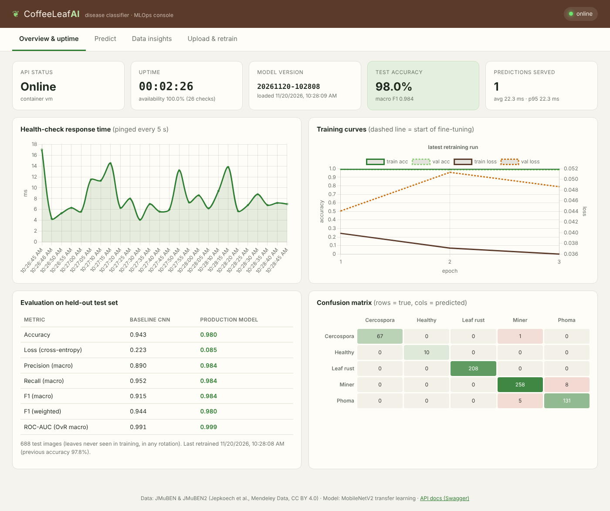
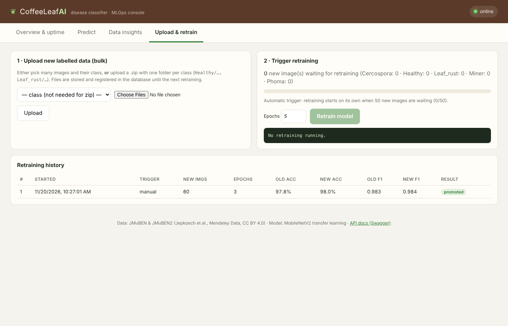
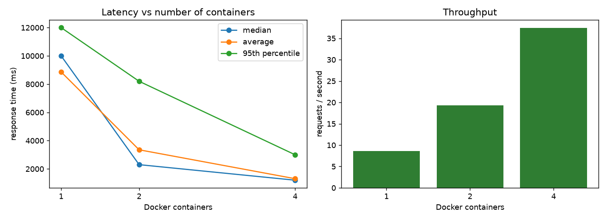

# CoffeeLeaf: Coffee Leaf Disease Classification (end-to-end MLOps)

An image classification pipeline that diagnoses **coffee leaf diseases from a photo**: data acquisition, preprocessing, transfer
learning, evaluation, a REST API, a web dashboard, user-triggered and automatic **retraining**, Docker scaling and **Locust** load testing.

| | |
|---|---|
| 🎥 **Video demo** | `https://youtu.be/<your-video-id>` |
| 🌐 **Live app** | https://coffeeleaf-keyla.onrender.com (free tier: the first visit after 15 idle minutes takes ~1 min to wake up) |
| 📘 **API docs (Swagger)** | https://coffeeleaf-keyla.onrender.com/docs |
| 📓 **Notebook** | [`notebook/coffee_leaf_disease.ipynb`](notebook/coffee_leaf_disease.ipynb) |

---

## 1. Project description

Leaf diseases such as **coffee leaf rust** can destroy a large share of a coffee harvest. Diagnosis from a phone photo helps farmers
act early. The model classifies a leaf image into five classes:

| Class | Meaning |
|---|---|
| `Cercospora` | Cercospora leaf spot (*Cercospora coffeicola*) |
| `Healthy` | no disease |
| `Leaf_rust` | Coffee leaf rust (*Hemileia vastatrix*) |
| `Miner` | Coffee leaf miner (*Leucoptera coffeella*) damage |
| `Phoma` | Phoma leaf spot / blight |

**Data (images, CC BY 4.0, Jepkoech et al., Mendeley Data):**
[JMuBEN](https://data.mendeley.com/datasets/t2r6rszp5c/1) (Cercospora, Leaf rust, Phoma) and
[JMuBEN2](https://data.mendeley.com/datasets/tgv3zb82nd/1) (Healthy, Miner).

### Data audit: most of the download is duplicates
The downloads contain 28,338 files, mostly exact duplicates and rotated/flipped copies of the same photos.

| Class | Files downloaded | Unique files | Distinct leaves | Train | Val | Test |
|---|---:|---:|---:|---:|---:|---:|
| Cercospora | 7,681 | 322 | 81 | 209 | 45 | 68 |
| Healthy | 2,885 | 60 | 12 | 40 | 10 | 10 |
| Leaf_rust | 8,336 | 1,042 | 521 | 678 | 156 | 208 |
| Miner | 2,865 | 1,321 | 460 | 857 | 198 | 266 |
| Phoma | 6,571 | 691 | 181 | 447 | 108 | 136 |
| **Total** | **28,338** | **3,436** | **1,255** | **2,231** | **517** | **688** |

A random split would put copies of the same leaf in both train and test and inflate the scores, so duplicates are removed and the
data is **split by leaf**: no rotation or flip of a test leaf is ever trained on.
*Limitation:* the full JMuBEN2 release has ~19,000 Healthy files but only **63 unique images**, so Healthy has few distinct leaves
and its test score (10 images) has high variance. New field photos can be added through the app's upload + retrain feature.

---

## 2. Results (held-out test set, 688 images)

| Metric | Baseline CNN (from scratch) | **MobileNetV2 transfer learning (production)** |
|---|---:|---:|
| Accuracy | 0.943 | **0.978** |
| Loss (cross-entropy) | 0.223 | **0.085** |
| Precision (macro) | 0.890 | **0.984** |
| Recall (macro) | 0.952 | **0.983** |
| F1 (macro) | 0.915 | **0.983** |
| ROC-AUC (one-vs-rest, macro) | 0.991 | **0.999** |

All remaining errors are Miner ↔ Phoma confusions (both show brown necrotic lesions).

**Optimisation:** ImageNet pre-trained MobileNetV2 (frozen, then top 30 layers fine-tuned), Adam with learning-rate reduction,
**early stopping**, **Dropout + L2** regularisation, data augmentation, class weights for the 22:1 imbalance, and a
**hyper-parameter search** (learning rate × dropout) on the validation set.

---

## 3. What the app does

| Feature | Where |
|---|---|
| **Model up-time**: status, uptime, availability, health-check latency chart | *Overview & uptime* tab, `GET /health` |
| **Model evaluation in production**: test metrics, confusion matrix, training curves, request latency | *Overview* tab, `GET /model`, `GET /stats` |
| **Prediction**: upload one leaf photo → class, confidence, all class probabilities | *Predict* tab, `POST /predict` |
| **Data visualisations**: dataset audit + 3 interpreted features | *Data insights* tab, `GET /insights` |
| **Bulk upload**: many images + a class, or a zip with one folder per class, stored in SQLite | *Upload & retrain* tab, `POST /upload` |
| **Retraining**: a button, plus an **automatic trigger** when 50 new images are waiting | *Upload & retrain* tab, `POST /retrain` |

| Overview & uptime | Prediction |
|---|---|
|  |  |
| **Data insights** | **Upload & retrain** |
|  |  |

### The three features and the story they tell
1. **Greenness (Excess-Green index).** Healthy leaves are by far the greenest (mean 0.70); every disease lowers greenness as green
   tissue turns yellow or brown, and Leaf rust is the least green (0.06). Greenness alone separates healthy from diseased leaves.
2. **Lesion fraction** (share of the leaf that is not green) acts as a severity score: Healthy ≈ 0.01, Miner 0.32, Cercospora 0.48,
   Phoma 0.52, Leaf rust 0.75. The diseases overlap, so colour alone cannot tell them apart: the CNN has to learn lesion *shape* and *texture*.
3. **Texture (edge strength).** Phoma (9.7) and Miner (7.6) images have the sharpest lesion borders; Leaf rust images are the smoothest
   (2.8) because they are blurred close-ups. That is a **dataset artefact** the model could exploit, and the reason retraining on new
   field photos matters.

---

## 4. How the deployed model works, and how it is retrained

The notebook trains the full Keras model (`models/coffee_leaf_model.h5`). For deployment it is exported in two parts that give
**identical predictions** (same class on all 688 test images; notebook section 7.1), so the API runs without TensorFlow in
~100 MB of RAM and fits a free 512 MB cloud instance:

```
image ─► feature_extractor.tflite ─► 1,280 features ─► classifier_head.npz ─► 5 class probabilities
         (fine-tuned MobileNetV2, TensorFlow Lite)      (trained Dense 128 + Dense 5, NumPy)
```

```
Upload (UI / API) ──► data/uploads/<class>/  +  SQLite database (status = pending)
                            │
   trigger: "Retrain model" button  OR  automatic when 50 images are pending
                            ▼
 1. Preprocess  - validate, RGB, resize 128×128, de-duplicate, extract features, reject non-leaf images
 2. Data        - stored features of the existing training images + the new ones
 3. Start point - the CURRENT production model (our own trained model) as the pre-trained model
 4. Fine-tune   - Adam, class weights, L2, early stopping on the validation set
 5. Evaluate    - old vs. new model on the same held-out test set
 6. Promote     - only if accuracy and macro-F1 do not drop; the old model is archived
 7. Log         - stored in the database and shown live in the UI; every container reloads the new model
```

Keeping MobileNetV2 fixed during retraining is a deliberate trade-off: retraining takes seconds and fits in 512 MB.
Code: [`src/retrain.py`](src/retrain.py), [`src/serving.py`](src/serving.py), [`src/database.py`](src/database.py).

**Images that are not coffee leaves.** A classifier always picks one of its classes, even for a photo of a person. So before
diagnosing, the app measures how far the image's features are from its 5 nearest training images (cosine distance). Above 0.47
it answers *"This doesn't look like a coffee leaf photo (it is far from every image the model was trained on), so no diagnosis is
given."* All 688 test leaves pass this check. Retraining applies the same check to uploads, so non-leaf images never enter the training data.

---

## 5. Repository structure

```
coffee_leaf_mlops/
├── README.md
├── notebook/coffee_leaf_disease.ipynb   # acquisition, audit, EDA, preprocessing, training, evaluation, export
├── src/
│   ├── config.py                        # paths and settings
│   ├── data_acquisition.py              # Mendeley zips → de-duplicated, leaf-grouped data/train & data/test
│   ├── preprocessing.py                 # image loading/resizing, features, insights
│   ├── model.py                         # architecture, training, evaluation, export for serving
│   ├── serving.py                       # lightweight model used by the API
│   ├── prediction.py                    # prediction
│   ├── retrain.py                       # upload ingestion + retraining pipeline
│   └── database.py                      # SQLite: uploads + training runs
├── api/main.py                          # FastAPI app (also serves the UI)
├── ui/                                  # web dashboard
├── data/
│   ├── train/<class>/                   # 2,748 images (train + validation)
│   ├── test/<class>/                    # 688 held-out images
│   └── split_manifest.csv, embeddings.npz, insights.json, dataset_summary.json
├── models/
│   ├── coffee_leaf_model.h5             # trained Keras model
│   ├── feature_extractor.tflite, classifier_head.npz   # its export, used by the API
│   └── baseline_cnn.h5, metrics.json, class_names.json
├── samples/                             # demo images and zips for prediction and retraining
├── locustfile.py, scripts/              # load test
├── Dockerfile, docker-compose.yml, nginx/, render.yaml
└── requirements.txt, requirements-dev.txt, requirements-docker.txt
```

---

## 6. Setup

### Run locally (Python 3.11 or 3.12)
```bash
git clone https://github.com/KeylaNyacyesa/coffee_leaf_mlops.git
cd coffee_leaf_mlops
conda create -n coffeeleaf python=3.12 -y && conda activate coffeeleaf
pip install -r requirements-dev.txt
uvicorn api.main:app --port 8000
```
Open http://localhost:8000 (UI) and http://localhost:8000/docs (Swagger).
To re-run the notebook (~20 min on CPU): `jupyter notebook notebook/coffee_leaf_disease.ipynb`.

### Docker Compose (several containers behind nginx)
```bash
docker compose up -d --build --scale api=3     # UI + API on http://localhost:8080
docker compose down -v                         # stop and reset
```

### Cloud deployment (Render, free)
1. Push the repository to GitHub.
2. On https://dashboard.render.com: **New → Web Service** → this repository → Language **Docker**, Instance type **Free**,
   Health check path `/health`, environment variable `TF_NUM_THREADS=1` → **Deploy Web Service**.
3. The app is live at `https://<service-name>.onrender.com`; every push to `main` redeploys it.

### Using the app
- **Predict:** *Predict* tab → an image from `samples/predict/` → **Predict**.
- **Retrain with the button:** *Upload & retrain* tab → upload `samples/retrain_batch_small.zip` (25 images) → **Retrain model**.
- **Automatic retraining:** upload `samples/retrain_batch.zip` (60 images, above the threshold of 50).

---

## 7. Flood request simulation (Locust)

`locustfile.py` simulates 100 users, each sending a random test image to `/predict` every 0.5–1.5 s.
[`scripts/run_load_tests.py`](scripts/run_load_tests.py) runs this load for 60 s against **1, 2 and 4 Docker containers**
(each limited to 1 CPU and 512 MB) behind nginx, and writes `load_test_results/`.

```bash
python scripts/run_load_tests.py      # Docker Desktop must be running
```

| Containers | Requests | Failures | Throughput (req/s) | Avg (ms) | Median (ms) | p95 (ms) | p99 (ms) | Max (ms) |
|---:|---:|---:|---:|---:|---:|---:|---:|---:|
| 1 | 502 | 0 | 8.6 | 8862 | 10000 | 12000 | 15000 | 16641 |
| 2 | 1134 | 0 | 19.3 | 3352 | 2300 | 8200 | 8600 | 12012 |
| 4 | 2235 | 0 | 37.4 | 1306 | 1200 | 3000 | 3900 | 6919 |



**Interpretation:** Throughput scaled almost linearly with the number of containers: 8.6 → 19.3 → 37.4 requests/s (4.3× with 4
containers), and the median response time fell from 10 s to 1.2 s, with 0 failed requests in all runs. With one container (1 CPU),
100 users send far more requests than it can serve, so requests wait in a queue and the response time is mostly waiting time.
Each added container adds one CPU of capacity, so the queue shrinks. At 4 containers the 95th percentile is still 3 s, so 100 users
still exceed capacity; more containers (up to the PC's CPU cores) would be needed for sub-second responses.
The free cloud plan runs a single instance, so the container comparison was done locally with Docker.

---

## Credits
Dataset: Jepkoech, J., Mugo, D. M., Kenduiywo, B. K., Too, E. C. (2021). *Arabica coffee leaf images dataset for coffee leaf disease
detection and classification.* Data in Brief 36, 107142. https://doi.org/10.1016/j.dib.2021.107142 (CC BY 4.0).
Chart.js (MIT) is bundled in `ui/vendor/`.