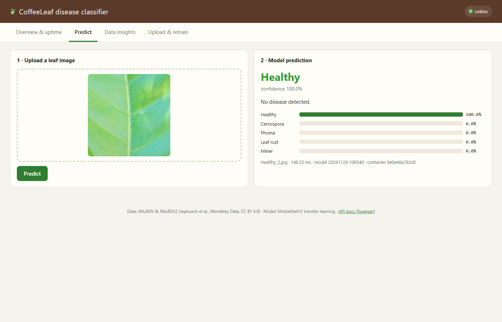
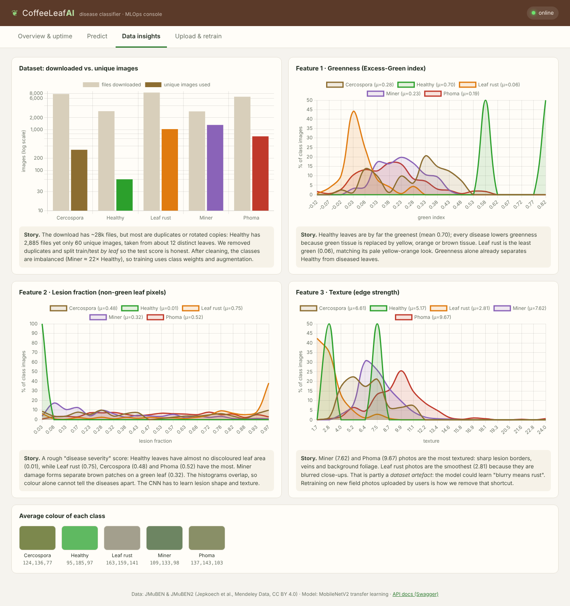

# CoffeeLeaf AI: Coffee Leaf Disease Classification (end-to-end MLOps)

An image classification pipeline that diagnoses **coffee leaf diseases from a photo**, covering data acquisition, preprocessing,
transfer learning, evaluation, a REST API, a web dashboard, user-triggered and automatic **retraining**, Docker scaling and
**Locust** load testing.

| | |
|---|---|
| 🎥 **Video demo** | `https://youtu.be/<your-video-id>` |
| 🌐 **Live app** | `https://coffeeleaf-keyla.onrender.com` (free tier: the first visit after 15 idle minutes takes ~1 min to wake up) |
| 📘 **API docs (Swagger)** | `https://coffeeleaf-keyla.onrender.com/docs` |
| 📓 **Notebook** | [`notebook/coffee_leaf_disease.ipynb`](notebook/coffee_leaf_disease.ipynb) |

---

## 1. Project description

Most coffee is grown by smallholder farmers, and leaf diseases such as **coffee leaf rust** can wipe out a large share of a harvest.
Early, cheap diagnosis from a phone photo helps farmers act before a disease spreads. The model classifies a leaf image into five classes:

| Class | Meaning |
|---|---|
| `Cercospora` | Cercospora leaf spot (*Cercospora coffeicola*) |
| `Healthy` | no disease |
| `Leaf_rust` | Coffee leaf rust (*Hemileia vastatrix*) |
| `Miner` | Coffee leaf miner (*Leucoptera coffeella*) damage |
| `Phoma` | Phoma leaf spot / blight |

**Data (images, CC BY 4.0, Jepkoech et al., Mendeley Data):**
- JMuBEN: https://data.mendeley.com/datasets/t2r6rszp5c/1 (Cercospora, Leaf rust, Phoma)
- JMuBEN2: https://data.mendeley.com/datasets/tgv3zb82nd/1 (Healthy, Miner)

### Data audit: most of the download is duplicates
The downloads contain 28,338 files, but they are mostly **copies**: exact duplicates plus rotated/flipped versions of the same photo.

| Class | Files downloaded | Unique files (MD5) | Distinct leaves (rotation-invariant hash) | Train | Val | Test |
|---|---:|---:|---:|---:|---:|---:|
| Cercospora | 7,681 | 322 | 81 | 209 | 45 | 68 |
| Healthy | 2,885 | 60 | 12 | 40 | 10 | 10 |
| Leaf_rust | 8,336 | 1,042 | 521 | 678 | 156 | 208 |
| Miner | 2,865 | 1,321 | 460 | 857 | 198 | 266 |
| Phoma | 6,571 | 691 | 181 | 447 | 108 | 136 |
| **Total** | **28,338** | **3,436** | **1,255** | **2,231** | **517** | **688** |

A random split would put copies of the same leaf in both train and test and give inflated scores. This project removes duplicates and
**splits by leaf group**, so no rotation or flip of a test leaf is ever seen in training. The scores below are honest generalisation estimates.
*Limitation:* this project used a random **sample** of JMuBEN2 (2,885 Healthy / 2,865 Miner files of 18,985 / 16,979). We checked the full release:
its ~19,000 Healthy files contain only **63 unique images**, so the small number of distinct Healthy leaves (~12) comes from the dataset itself, not
our sampling. The Healthy test score (10 images) therefore has high variance. More Healthy photos would have to come from new field images, which the
app's upload + retrain feature is built to take in.

---

## 2. Results (held-out test set, 688 images)

| Metric | Baseline CNN (from scratch, no tuning) | **MobileNetV2 transfer learning (production)** |
|---|---:|---:|
| Accuracy | 0.943 | **0.978** |
| Loss (cross-entropy) | 0.223 | **0.085** |
| Precision (macro) | 0.890 | **0.984** |
| Recall (macro) | 0.952 | **0.983** |
| F1 (macro) | 0.915 | **0.983** |
| F1 (weighted) | 0.944 | **0.978** |
| ROC-AUC (one-vs-rest, macro) | 0.991 | **0.999** |

Per-class F1 (production): Cercospora 1.00 · Healthy 1.00 · Leaf rust 1.00 · Miner 0.97 · Phoma 0.95. All remaining errors are Miner ↔ Phoma confusions,
which are visually similar brown necrotic lesions.

**Optimisation techniques:** ImageNet pre-trained MobileNetV2 (frozen, then top 30 layers fine-tuned), Adam optimiser with `ReduceLROnPlateau`,
**early stopping** (restores best weights), **Dropout + L2** regularisation, data augmentation (flips, rotation, zoom, contrast), class weights for
the 22:1 imbalance, and a **hyper-parameter search** (learning rate × dropout) selected on the validation set.

---

## 3. What the app does

| Feature | Where |
|---|---|
| **Model up-time**: live status, uptime counter, availability %, health-check latency chart | *Overview & uptime* tab, `GET /health` |
| **Model evaluation in production**: test metrics, confusion matrix, training curves, request latency | *Overview* tab, `GET /model`, `GET /stats` |
| **Predict one image**: upload a leaf photo, get class, confidence, all class probabilities | *Predict* tab, `POST /predict` |
| **Data visualisations**: dataset audit + 3 interpreted features (greenness, lesion fraction, texture) + class colours | *Data insights* tab, `GET /insights` |
| **Bulk upload**: many images + a class, or a zip with one folder per class; saved to disk and registered in SQLite | *Upload & retrain* tab, `POST /upload` |
| **Retraining trigger**: a button, plus an **automatic trigger** when ≥ `RETRAIN_THRESHOLD` (default 50) new images are waiting | *Upload & retrain* tab, `POST /retrain` |

*Screenshots taken after one retraining run on `samples/retrain_batch.zip` (accuracy 97.8% → 98.0%, macro F1 0.983 → 0.984, promoted).*

| Overview & uptime | Prediction |
|---|---|
|  |  |
| **Data insights** | **Upload & retrain** |
|  |  |

### The three features and the story they tell
1. **Greenness (Excess-Green index).** Healthy leaves are by far the greenest (mean 0.70). Every disease lowers greenness as chlorophyll tissue
   turns yellow, orange or brown, and Leaf rust is the least green (0.06). Greenness alone separates healthy from diseased leaves.
2. **Lesion fraction** (share of leaf pixels that are not green) works as a crude severity score: Healthy ≈ 0.01, Miner 0.32 (separate brown mines on a
   green leaf), Cercospora 0.48, Phoma 0.52, Leaf rust 0.75. The diseases overlap heavily, so colour alone cannot tell them apart, and the CNN has to learn
   lesion *shape* and *texture*.
3. **Texture (edge strength).** Phoma (9.7) and Miner (7.6) images have the sharpest lesion borders; Leaf rust images are the smoothest (2.8) because the
   rust photos are blurred close-ups. That is a **dataset artefact** the model could exploit ("blurry means rust"), and it is the main reason the
   retraining loop matters: new field photos remove that shortcut.

---

## 4. How the deployed model works, and how it is retrained

The notebook trains the full Keras model (`models/coffee_leaf_model.h5`). For deployment it is exported in two parts that
together give **identical predictions** (same class on all 688 test images, same accuracy and F1; notebook section 7.1):

```
image ─► feature_extractor.tflite ─► 1,280 features ─► classifier_head.npz ─► 5 class probabilities
         (Rescaling + fine-tuned MobileNetV2,           (trained Dense 128 + Dense 5,
          TensorFlow Lite)                               NumPy)
```

The API therefore needs no TensorFlow: it starts in seconds and uses ~100 MB of RAM (~250 MB peak while retraining),
so it runs on a free 512 MB cloud instance. TensorFlow itself needs ~600 MB, and the full Keras fine-tuning ~1.5 GB.

```
UI / API upload ──► data/uploads/<class>/  +  SQLite (data/mlops.db, status = pending)
                            │
   trigger: "Retrain model" button  OR  automatic when pending ≥ RETRAIN_THRESHOLD (50)
                            ▼
 1. Preprocess  - validate, RGB, resize 128×128, de-duplicate vs. existing data → data/train/<class>/
 2. Features    - new images go through OUR fine-tuned MobileNetV2 (feature_extractor.tflite);
                  the features of all existing images are stored in data/embeddings.npz
 3. Start point - the CURRENT production classifier head (classifier_head.npz) = the custom pre-trained model
 4. Fine-tune   - on existing + new training features (Adam, class weights, L2, early stopping on validation)
 5. Evaluate    - old vs. new model on the same held-out test set
 6. Promote     - only if neither accuracy nor macro-F1 drops by > 2 points; the old head is archived in models/archive/
 7. Log         - run stored in the training_runs table and shown live in the UI; every container reloads the new model
```

Keeping MobileNetV2 fixed during retraining is a deliberate deployment trade-off: retraining takes seconds and fits in 512 MB.
Code: [`src/retrain.py`](src/retrain.py), [`src/serving.py`](src/serving.py), [`src/database.py`](src/database.py).
Command line: `python -m src.retrain --upload-dir path/to/<class>/<images>`.

**Images that are not coffee leaves.** A classifier always picks one of its classes, even for a photo of a person. So before
diagnosing, the app measures how far the image's features are from its 5 nearest training images (cosine distance). Above 0.47 the app answers *"This doesn't look like a coffee leaf photo (it is far from every image the model was trained on), so no diagnosis is given."* Retraining applies the same check to uploads, so non-leaf images never enter the training data.

---

## 5. Repository structure

```
coffee_leaf_mlops/
├── README.md
├── notebook/
│   └── coffee_leaf_disease.ipynb   # acquisition, audit, EDA, preprocessing, training, evaluation (executed)
├── src/
│   ├── config.py                   # paths + settings (env-overridable)
│   ├── data_acquisition.py         # Mendeley zips → de-duplicated, group-split data/train & data/test
│   ├── preprocessing.py            # image loading/resizing, features, insights
│   ├── model.py                    # architecture, training, evaluation, save/load, export for serving
│   ├── serving.py                  # lightweight model used by the API: TFLite features + NumPy head
│   ├── prediction.py               # thread-safe predictor with hot reload
│   ├── retrain.py                  # upload ingestion + retraining pipeline
│   └── database.py                 # SQLite: uploads + training runs
├── api/main.py                     # FastAPI app (serves the UI too)
├── ui/                             # dashboard (HTML/CSS/JS, Chart.js bundled locally)
├── data/
│   ├── train/<class>/*.jpg         # 2,748 images (train + validation, see split_manifest.csv)
│   ├── test/<class>/*.jpg          # 688 held-out images
│   ├── split_manifest.csv          # every image's split + leaf group
│   ├── embeddings.npz              # stored features of every image (used by retraining)
│   └── dataset_summary.json, insights.json
├── models/
│   ├── coffee_leaf_model.h5        # trained Keras model (MobileNetV2)
│   ├── feature_extractor.tflite    # its exported MobileNetV2 part (used by the API)
│   ├── classifier_head.npz         # its exported classifier head (used by the API, updated by retraining)
│   ├── baseline_cnn.h5             # baseline for comparison
│   ├── metrics.json, class_names.json
├── samples/                        # demo files: predict/ images + retrain_batch(_small).zip
├── docs/screenshots/               # UI screenshots used in this README
├── locustfile.py                   # flood test
├── scripts/                        # load-test runner, summary, demo-file generator
├── Dockerfile, docker-compose.yml, nginx/nginx.conf
├── render.yaml                     # cloud deployment (Render)
└── requirements.txt, requirements-dev.txt, requirements-docker.txt   # local / + notebook & Locust / Docker (no TensorFlow)
```

---

## 6. Setup

### Option A: run locally with Python 3.11 or 3.12
```bash
git clone https://github.com/<you>/coffee_leaf_mlops.git
cd coffee_leaf_mlops
conda create -n coffeeleaf python=3.12 -y && conda activate coffeeleaf      # or: python -m venv .venv
pip install -r requirements-dev.txt
uvicorn api.main:app --port 8000
```
Open **http://localhost:8000** (UI) and **http://localhost:8000/docs** (Swagger).

> TensorFlow 2.21 (for the notebook) is pinned so the saved `.h5` loads exactly as trained. The API itself only needs `requirements-docker.txt`.

**Re-run the notebook** (optional, ~20 min on CPU): `jupyter notebook notebook/coffee_leaf_disease.ipynb`.
**Rebuild the dataset from the original downloads** (optional):
`python -m src.data_acquisition --sources t2r6rszp5c-1.zip jmuben2_sample.zip`

### Option B: Docker (single container)
```bash
docker build -t coffee-leaf-api .
docker run -p 8000:8000 coffee-leaf-api
```

### Option C: Docker Compose, N containers behind nginx
```bash
docker compose up -d --build --scale api=3
# UI + API on http://localhost:8080 (nginx round-robins across the 3 containers)
docker compose down
```
The containers share volumes for `data/` and `models/`, so an upload or retrain in one container is visible to all, and every container
hot-reloads a newly promoted model within 10 s.

### Option D: cloud deployment on Render (free, no credit card)
1. Push the repository to GitHub (public).
2. Sign in at https://dashboard.render.com with GitHub → **New → Web Service** → pick the repository.
3. Settings: **Language** Docker, **Branch** main, **Instance type** Free, **Health check path** `/health`
   (under *Advanced*), environment variable `TF_NUM_THREADS` = `1`. Click **Deploy Web Service**.
4. The first build takes ~5 min; the app is then live at `https://<service-name>.onrender.com`.
   Every push to `main` redeploys automatically.

*Notes:* free instances sleep after 15 minutes without traffic (the next visit takes ~1 minute) and start from the
committed data and model again after a restart, so uploads and retrained models are kept only while the instance is up.
[`render.yaml`](render.yaml) holds the same settings as a Blueprint.

---

## 7. Using the app

**Predict:** *Predict* tab → drop an image (use `samples/predict/` or anything in `data/test/`) → **Predict**.
API: `curl -F "file=@samples/predict/Leaf_rust_1.jpg" http://localhost:8000/predict`

**Upload + retrain:** *Upload & retrain* tab → choose `samples/retrain_batch.zip` (60 labelled images, 12 per class) → **Upload**.
Because 60 ≥ the threshold of 50, retraining **starts automatically**. To use the button instead, upload `samples/retrain_batch_small.zip`
(25 images, below the threshold) and click **Retrain model**. Watch the live log, then the history
table shows old vs. new accuracy/F1 and whether the model was promoted; the *Overview* tab shows the new version and metrics.
API:
```bash
curl -F "files=@samples/retrain_batch.zip" http://localhost:8000/upload
curl -F "files=@leaf1.jpg" -F "files=@leaf2.jpg" -F "label=Healthy" http://localhost:8000/upload
curl -X POST "http://localhost:8000/retrain?epochs=5"
curl http://localhost:8000/retrain/status
```
`samples/retrain_batch.zip` is made by [`scripts/make_demo_samples.py`](scripts/make_demo_samples.py) from training images with new
augmentations, which is good for demonstrating the pipeline. For a real improvement, upload genuinely new field photos (Healthy most of all). Re-uploading an image that is already in the dataset is detected and rejected.

| Endpoint | Method | Purpose |
|---|---|---|
| `/` | GET | Web UI |
| `/health` | GET | status, uptime, container id, model version |
| `/stats` | GET | request count, prediction latency avg/p50/p95/p99 |
| `/model` | GET | evaluation metrics + training history of the current model |
| `/insights` | GET | dataset feature statistics for the visualisations |
| `/predict` | POST | `file`: one image → class + probabilities |
| `/upload` | POST | `files[]` (+ `label`) or zip(s) → stored for retraining |
| `/uploads` | GET | pending / used / rejected counts per class |
| `/retrain` | POST | start retraining (`epochs` query param) |
| `/retrain/status` | GET | live log + history of training runs |

Settings (environment variables): `RETRAIN_THRESHOLD` (50), `AUTO_RETRAIN` (true), `RETRAIN_EPOCHS` (30, with early stopping), `RETRAIN_LR` (5e-4), `PROMOTION_TOLERANCE` (0.02), `TF_NUM_THREADS` (all cores), `WORKERS` (1), `PORT` (8000).

---

## 8. Flood request simulation (Locust)

`locustfile.py` simulates farmers' phones: each user POSTs a random test image to `/predict` every 0.5–1.5 s (plus occasional `/health`).
[`scripts/run_load_tests.py`](scripts/run_load_tests.py) runs the same load against **1, 2 and 4 containers** (each limited to 1 CPU, 2 GB) behind nginx,
then [`scripts/summarize_load_tests.py`](scripts/summarize_load_tests.py) writes `load_test_results/summary.md` and `latency_vs_containers.png`.

```bash
python scripts/run_load_tests.py                     # 100 users, 60 s per configuration (Docker Desktop must be running)
# or interactively: docker compose up -d --scale api=2 && locust -f locustfile.py --host http://localhost:8080  → http://localhost:8089
```

### Results
<!-- Paste load_test_results/summary.md here after running the script, and add the chart: -->
<!--  -->

*Machine:* `<CPU model, cores, RAM>` · 100 concurrent users · spawn rate 10/s · 60 s per run

| Containers | Requests | Failures | Throughput (req/s) | Avg (ms) | Median (ms) | p95 (ms) | p99 (ms) |
|---:|---:|---:|---:|---:|---:|---:|---:|
| 1 | | | | | | | |
| 2 | | | | | | | |
| 4 | | | | | | | |

**Interpretation:** `<what happened to latency and throughput as containers were added, where it stopped scaling, and why (e.g. host CPU cores saturated)>`

For reference, a single uvicorn process (no Docker) on a 2-vCPU cloud VM served 30 concurrent users at ~26 req/s with a 17 ms median and 51 ms p95 latency, with 0 failures.

---

## 9. Video demo checklist
Camera **on** for the whole video. Show: (1) the live URL + uptime dashboard; (2) predicting an image whose true class you name first (e.g.
`samples/predict/Phoma_1.jpg`) → correct prediction; (3) the data-insights tab and the three feature stories; (4) bulk-uploading
`samples/retrain_batch.zip` → DB counts → retraining log → old vs. new metrics → promoted model version; (5) the Locust run / results table.

## Licence & credits
Dataset: Jepkoech, J., Mugo, D. M., Kenduiywo, B. K., Too, E. C. (2021). *Arabica coffee leaf images dataset for coffee leaf disease
detection and classification.* Data in Brief 36, 107142. https://doi.org/10.1016/j.dib.2021.107142 (JMuBEN, JMuBEN2 on Mendeley Data, CC BY 4.0). Chart.js (MIT) is bundled in `ui/vendor/`.
